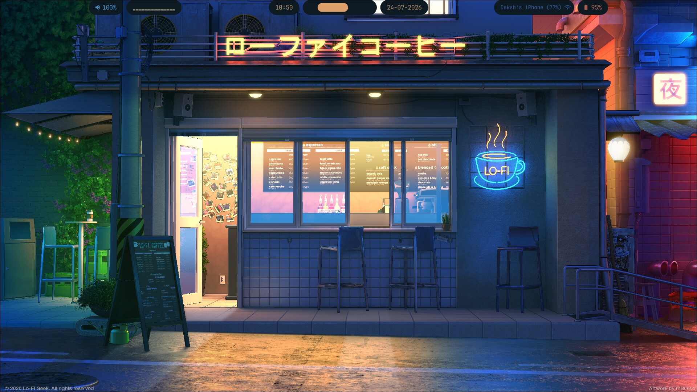
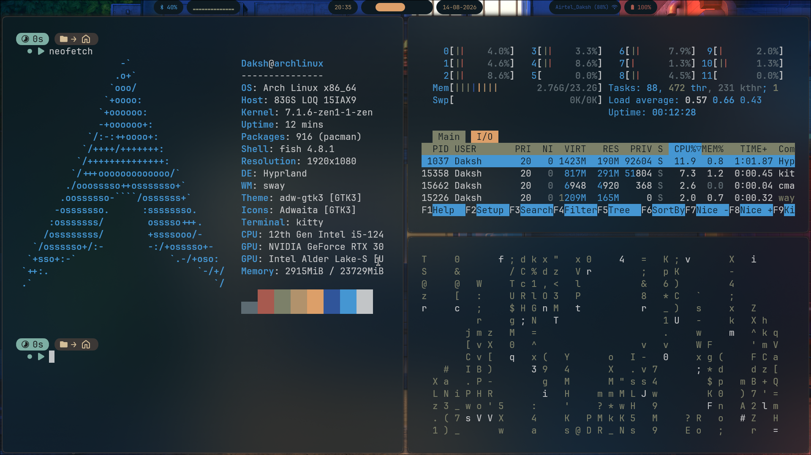
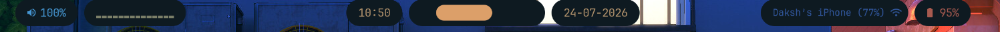
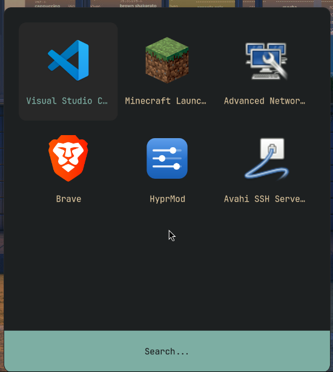
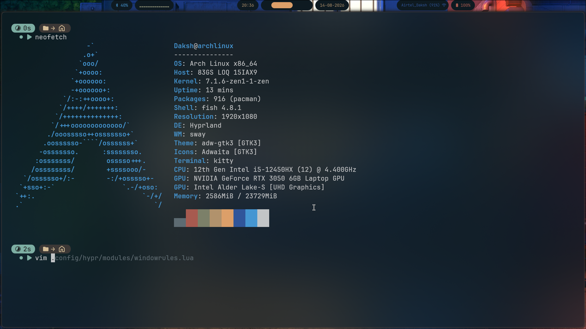
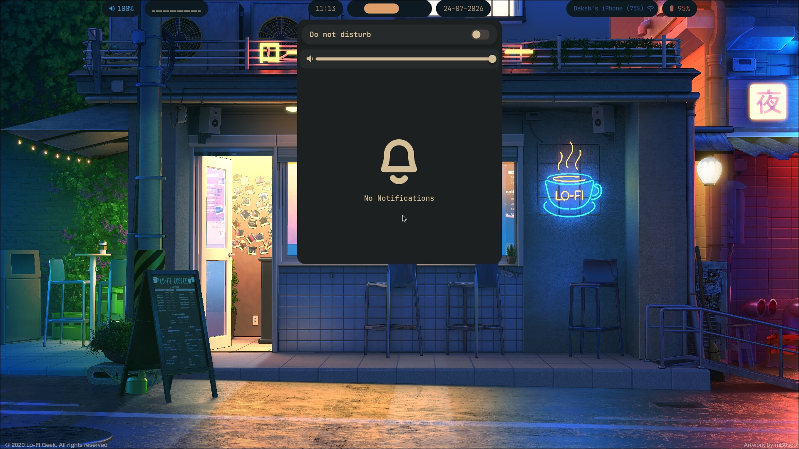
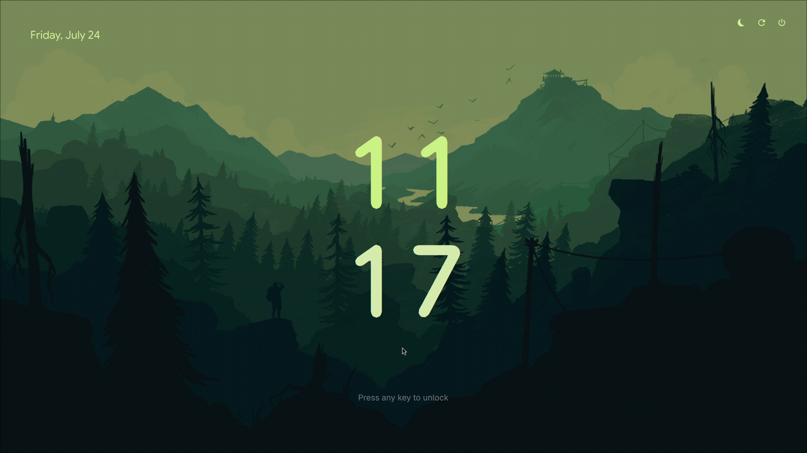
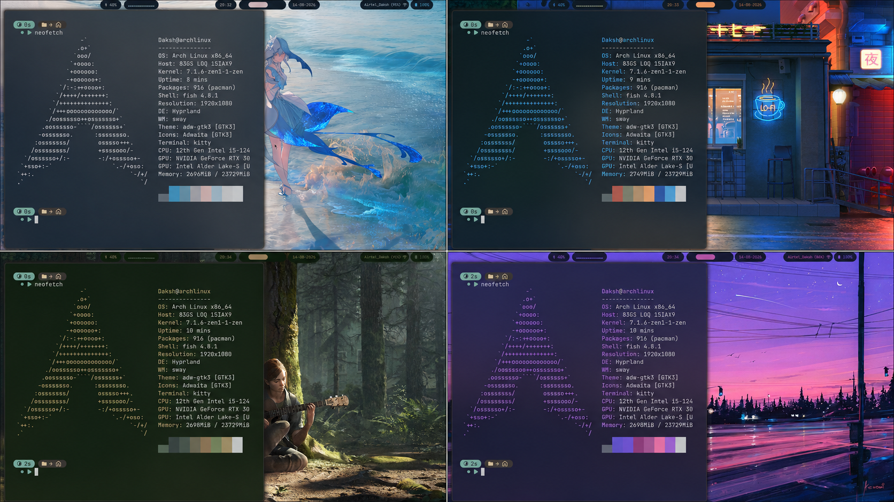

# HyprlandSetup

A personal Arch Linux Hyprland setup with dotfiles, theming, and a few helper scripts. The repository contains the desktop environment configuration, app-specific settings, and a package list for getting the whole experience up quickly.



## Repo layout

- `.config/` contains the main desktop configs for Hyprland, Waybar, Rofi, Kitty, SwayNC, wlogout, GTK theming, and more.
- `.local/bin/` contains helper scripts used by keybindings and theming actions.
- `.vimrc` is the Vim configuration, installed at the repo root since Vim reads it from `~/.vimrc`, not from `~/.config/`.
- `etc/` and `usr/` contain system-level configuration files and SDDM theme assets that should be installed into the real `/etc` and `/usr` directories on the machine.
- `assets/` contains sample wallpapers and ambient audio used by the wallpaper switcher.
- `essentials` is the package list used for this setup.

This repo covers the Hyprland desktop environment specifically. Personal/system-level setup unrelated to Hyprland itself (e.g. networking configuration) is intentionally kept out of scope.

## Quick setup

1. Install the packages from the essentials list:

```bash
yay -S --needed $(cat essentials)
```

2. Copy the dotfiles and shell config into place:

```bash
mkdir -p ~/.config ~/.local
cp -r .config/. ~/.config/
cp -r .local/. ~/.local/
cp .vimrc ~/.vimrc
chmod +x ~/.local/bin/*
```

3. Install the system-level config files:

```bash
sudo cp -r etc/* /etc/
sudo cp -r usr/* /usr/
```

4. Set up wallpapers and ambient audio for the switcher:

```bash
mkdir -p ~/Pictures/Wallpapers ~/Music/WallpaperAudio
cp assets/images/* ~/Pictures/Wallpapers/
cp assets/audio/* ~/Music/WallpaperAudio/
```

5. Install the Vim plugin used for the color scheme:

```bash
curl -fLo ~/.vim/autoload/plug.vim --create-dirs https://raw.githubusercontent.com/junegunn/vim-plug/master/plug.vim

vim +PlugInstall +qall
```

> I recommend also installing `gvim` to get system clipboard access in vim `sudo pacman -S gvim`.

6. Set the GTK theme so app accent colors respond to wallpaper changes:

```bash
gsettings set org.gnome.desktop.interface gtk-theme "adw-gtk3"
```

7. Generate an initial color palette before first launching Waybar/Nemo, so their color imports have something to read:

```bash
wal -i ~/Pictures/Wallpapers/<any-image> -nte
```

8. Reboot or start Hyprland and the relevant services.

---

## What is included

### Hyprland

Hyprland is the window manager for this setup, using its native Lua-based configuration system (introduced in Hyprland 0.55+) instead of the older hyprlang `.conf` format.

- Main entry: `.config/hypr/hyprland.lua`
- Keybindings: `.config/hypr/modules/keybinds.lua`
- Autostart: `.config/hypr/modules/autostart.lua`
- Environment variables: `.config/hypr/modules/env.lua`
- Animation/decoration config: `.config/hypr/modules/decorations.lua`

Quick setup:
- Install `hyprland` from `essentials`. No extra package is needed for the Lua config — it's built into Hyprland itself.
- `hyprmod` (also in `essentials`) is a separate, optional GTK settings GUI for Hyprland, unrelated to this repo's Lua config files.
- Copy `.config/hypr/` into `~/.config/hypr/`.

> After major Hyprland version updates, re-check animation feel and any fullscreen/focus keybind behavior against upstream's current `example/hyprland.lua` — internal defaults (like spring physics constants) can shift between versions even though this repo's config values stay the same.



### Waybar

Waybar provides the top status bar with workspaces, clock, network, sound, cava visualizer, and battery information. Colors are live-generated from the current wallpaper via Pywal (see the Wallpaper switcher section below).

- Config: `.config/waybar/config.jsonc`
- Styling: `.config/waybar/style.css`
- Launch script: `.config/waybar/scripts/`
- Static fallback colors: `.config/waybar/colours/gruvbox-material.css`
- Live-generated colors: `.config/waybar/colours/wal-generated.css` (regenerated on each wallpaper switch, not meant to be hand-edited)

Quick setup:
- Install `waybar-cava-git` and `cava` from `essentials`.
- Copy `.config/waybar/` into `~/.config/waybar/`.



### Rofi

Rofi is used as the application launcher, menu surface, and the wallpaper picker for the theme switcher.

- Launcher script: `.config/rofi/type-2/launcher.sh`
- Theme files: `.config/rofi/type-2/`
- Wallpaper picker theme: `.config/rofi/type-2/style-walset.rasi`

Quick setup:
- Install `rofi` from `essentials`.
- Copy `.config/rofi/` into `~/.config/rofi/`.



### Kitty

Kitty is the terminal emulator used throughout the setup. Colors update live in already-open windows via kitty's remote control socket, and persist to new windows via a generated Pywal template.

- Config: `.config/kitty/kitty.conf`
- Static color palette: `.config/kitty/colours/colours.conf`
- Live-generated colors: `~/.cache/wal/colours-kitty.conf` (regenerated on each wallpaper switch, not tracked in this repo)

Quick setup:
- Install `kitty` from `essentials`.
- Copy `.config/kitty/` into `~/.config/kitty/`.
- `kitty.conf` must include `allow_remote_control yes` and `listen_on unix:/tmp/kitty-socket` for live color updates to already-open windows to work.



### Sway Notification Center

SwayNC provides the notification UI and the notification daemon used by the desktop.

- Config: `.config/swaync/config.json`
- Styling: `.config/swaync/style.css`
- Scripts: `.config/swaync/scripts/`

Quick setup:
- Install `swaync` from `essentials`.
- Copy `.config/swaync/` into `~/.config/swaync/`.



### wlogout

wlogout provides the power menu (lock, logout, suspend, hibernate, reboot, shutdown), launched via a `hyprshutdown` script bound to `SUPER + L`.

- Layout: `.config/wlogout/layout`
- Styling: `.config/wlogout/style.css`
- Launcher script: `.local/bin/hyprshutdown`

Quick setup:
- Install `wlogout` from `essentials`.
- Copy `.config/wlogout/` into `~/.config/wlogout/`.
- Place `hyprshutdown` in `~/.local/bin/` and make it executable.


### SDDM and the Pixie theme

The login manager uses the Pixie SDDM theme, with the theme files installed under `/usr/share/sddm/themes/pixie/` and the selected theme configured in `/etc/sddm.conf.d/theme.conf`.

- Theme files: `usr/share/sddm/themes/pixie/`
- Theme selection: `etc/sddm.conf.d/theme.conf`

Quick setup:
- Install `sddm` and `pixie-sddm-git` from `essentials`.
- Copy the contents of `usr/` to `/usr/` and the contents of `etc/` to `/etc/`.



### Fish shell

Fish is the default shell in this setup. The main shell config is in `.config/fish/config.fish` and it enables Starship, adds `~/.local/bin` to the path, and sets the Qt theme for compatibility.

- Config: `.config/fish/config.fish`

Quick setup:
- Install `fish` from `essentials`.
- Copy `.config/fish/` into `~/.config/fish/`.

### Starship prompt

Starship provides the custom prompt shown in the terminal. The prompt styling and modules are defined in `.config/starship.toml`.

- Config: `.config/starship.toml`

Quick setup:
- Install `starship` from the package manager if needed.
- Copy `.config/starship.toml` to `~/.config/starship.toml`.

### Vim, Pywal, and wal.vim

The Vim setup uses the `wal.vim` plugin and applies the current Pywal color scheme, read live from the terminal's ANSI palette. The config lives at `.vimrc` at the repository root, and it should be installed as `~/.vimrc` on the machine.

- Config: `.vimrc`
- Plugin: `wal.vim`

Quick setup:
- Install the plugin manager and run `:PlugInstall` in Vim.
- The wallpaper switcher updates the Pywal cache and pushes it to the terminal, so the terminal and Vim colors stay in sync after changing the wallpaper.
- Note: on a fresh Vim install (no prior `~/.vimrc`), Vim auto-loads sane defaults (mouse support, etc.) via `defaults.vim`. Once a custom `.vimrc` exists, that auto-load stops, so this repo's `.vimrc` explicitly sources `$VIMRUNTIME/defaults.vim` to keep that behavior.

### GTK theming (Nemo, and other GTK apps)

Matugen generates Material You colors from the current wallpaper and writes them into GTK's named-color override system, so Nemo (and other GTK3/4 apps) shift accent colors along with the wallpaper. This requires the `adw-gtk3` theme specifically — plain Adwaita mostly ignores these overrides.

- Matugen config: `.config/matugen/config.toml`
- Template: `.config/matugen/templates/gtk.tmpl`
- GTK imports: `.config/gtk-3.0/gtk.css`, `.config/gtk-4.0/gtk.css`

Quick setup:
- Install `adw-gtk-theme` from `essentials`, then set it active:
  `gsettings set org.gnome.desktop.interface gtk-theme "adw-gtk3"`
- Copy the `.config/matugen/`, `.config/gtk-3.0/`, and `.config/gtk-4.0/` folders into `~/.config/`.

> Note: this currently produces a fairly subtle effect under Adwaita-family styling — mostly shifts accent/selection colors, not full window theming. Revisiting for a stronger effect.

### Wallpaper switcher and theming

The wallpaper switcher is the centerpiece of the theming flow. It sets the wallpaper via `awww`, generates a color palette via Pywal, generates a Material You palette via Matugen, refreshes Waybar/SwayNC/Nemo, pushes live colors to open Kitty windows, and optionally plays looping ambient audio tied to the selected wallpaper.

- Launcher: `.local/bin/walset.sh`
- Backend: `.local/bin/walset-backend.sh`
- Audio toggle (pause/resume): `.local/bin/walset-audio-toggle.sh`
- Rofi theme: `.config/rofi/type-2/style-walset.rasi`
- Pywal templates: `.config/wal/templates/` (Waybar and Kitty color exports)

Quick setup:
- Install `python-pywal16`, `matugen-bin`, `mpv`, `playerctl`, `awww`, `rofi`, and the related desktop components from `essentials`.
- Place the scripts in `~/.local/bin/` and make sure `~/Pictures/Wallpapers` exists for the wallpaper picker to work.
- For ambient audio: drop a file named after the wallpaper (e.g. `sunset.jpg` → `sunset.mp3`) into `~/Music/WallpaperAudio/`. Not every wallpaper needs a matching track — audio is skipped for any wallpaper without one.
- Ambient audio only starts if nothing else is currently playing (checked via `playerctl`), and only checks at the moment of switching — it won't duck automatically if other media starts later.
- Toggle bound to `SUPER + SHIFT + A`.



---

## Notes

- The files inside `usr/` and `etc/` must be placed into the real system directories, not into your home folder.
- Some scripts in `.local/bin/` are referenced by keybindings and notification actions, so keeping that folder in place is important.
- The wallpaper switching helper is located in `.local/bin/walset.sh` and expects wallpapers in `~/Pictures/Wallpapers`.
- This repo intentionally excludes personal/system-level configuration not specific to the Hyprland desktop itself (e.g. network manager backend selection), to keep scope focused on the desktop environment.
- After Hyprland updates, config values (especially animation/spring constants) may need re-tuning even without editing this repo, since Hyprland's internal interpretation of those values can shift between versions.
